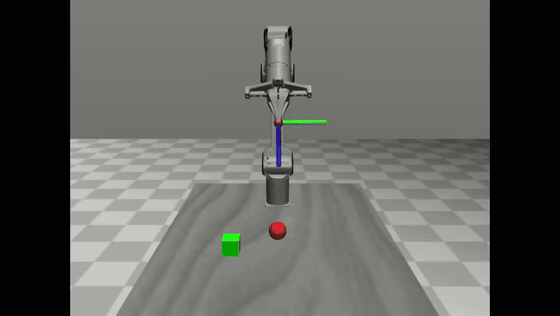
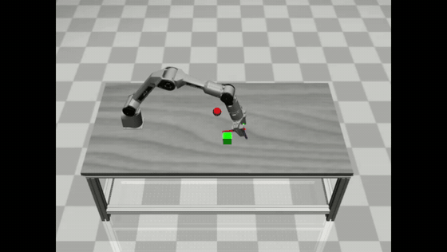
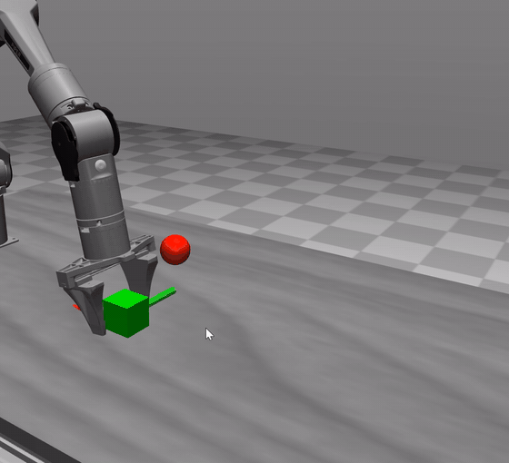
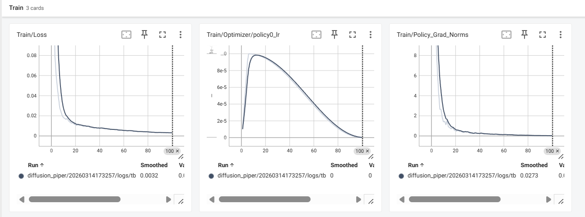
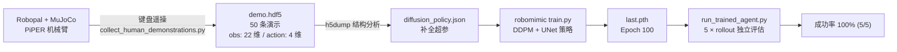

<div align="center">

# 基于 Diffusion Policy 的 PiPER 机械臂抓取策略优化

**MuJoCo 仿真 · 50 条人类遥操演示 · 模仿学习闭环调优**

[](https://www.python.org/)
[](https://pytorch.org/)
[](https://mujoco.org/)
[](https://github.com/ARISE-Initiative/robomimic)
[](https://github.com/NoneJou072/robopal)
[](LICENSE)

成功率 **40% (2/5) → 100% (5/5)**

</div>

---

## 一、结果

| 指标 | 基线 | 本项目（最终） |
| :--- | :---: | :---: |
| 独立推理成功率 `run_trained_agent.py` | **40%**（2/5） | **100%**（5/5） |
| Return | 0.4 | 1.0 |
| 训练损失（Epoch 100，平滑后） | — | ≈ 0.0032 |
| 训练内存占用 | — | ≈ 4.0 GB |
| 训练配置 | 原始模板 | 见 [`config/diffusion_policy.json`](config/diffusion_policy.json) |

> - **40%** 是项目给定的基线水平；本仓库在修好评估脚本后，用初始策略也复现到 2/5。
> - **100%** 是在「重采演示数据 + 最终训练配置」下重新训练后，`run_trained_agent.py` 独立评估的结果（5/5 全部成功）。
> - 评测命令、原始日志、TensorBoard 与 JSON 结果分别在 [复现](#五复现) 和 [`results/`](results/)，数字可逐项追溯。

---

## 二、演示

<table>
<tr>
<td width="50%" align="center"><b>Task 1-A｜人类遥操采集演示数据</b><br/>
</td>
<td width="50%" align="center"><b>Task 1-B｜演示回放校验</b><br/>
</td>
</tr>
</table>

<table>
<tr>
<td width="50%" align="center"><b>Task 2｜训练后策略自主抓取</b><br/>
</td>
<td width="50%" align="center"><b>训练曲线（TensorBoard）</b><br/>
</td>
</tr>
</table>

- 完整采集 / 回放视频：[`media/collect.mp4`](media/collect.mp4)、[`media/playback.mp4`](media/playback.mp4)
- 推理过程 4× 延时：[`media/rollout_timelapse_4x.mp4`](media/rollout_timelapse_4x.mp4)
- 实验报告：[`docs/report-zh.pdf`](docs/report-zh.pdf)｜踩坑与修复手册：[`docs/pitfalls-and-fixes-zh.docx`](docs/pitfalls-and-fixes-zh.docx)

---

## 三、任务与流水线

任务分两段：先采数据，再训练策略。



- **感知/控制输入**：22 维低维状态（关节位姿 + 夹爪 + 物体位姿），而非图像，因此策略侧只走 `obs/low_dim` 分支，训练与推理开销都很小。
- **动作空间**：4 维末端位姿增量 + 夹爪开合。
- **策略**：Diffusion Policy（DDPM，UNet 骨干，EMA），预测 16 步动作时域。

---

## 四、我做了什么

### 4.1 Task 1：演示数据采集与回放

1. 补全 `robopal/assets/scenes/grasping.xml` 中 `TODO`——把 `<include>` / `<mesh>` 指向本机 `table.xml` / `table.STL` 的真实路径，场景才能正常加载。
2. 用键盘遥操采集"开夹爪 → 对齐绿色方块 → 夹取 → 搬运到红球位置"的完整轨迹。
3. **采集了两轮**：第一轮回放时发现部分轨迹"没真正夹起方块""动作过猛"，按"完整、连贯、平滑"的标准重新采集 50 条，人工回放确认除首条外都能稳定完成抓取。
4. 补全 `play_back_demonstrations.py` 的 `TODO`，把数据路径替换为本机 collections 目录，并加入逐 episode 回放与模型加载校验。

> 结论：模仿学习里，**演示数据质量比超参更决定上限**。第一轮里"没真正夹起方块"的轨迹会让策略学到错误的闭合时机，参数量再大也学不出稳定抓取；重采后同样的配置才收敛得动。

### 4.2 Task 2：训练与推理链路

- 用 `h5dump` 导出 `demo.hdf5` 结构，确认轨迹编号从 `demo_0` 开始、`actions` 为 `(T,4)`、`obs/low_dim` 为 `(T,22)`，据此确定 `dataset_keys` 与低维训练路径是匹配的。
- 补全配置文件全部 `TODO`：`save.every_n_epochs`、`rollout.n`、`seq_length`、`frame_stack`、`observation_horizon`、`action_horizon`、`prediction_horizon`。
- 完成训练 → checkpoint → 独立推理评估的闭环。

### 4.3 关键修复：先让评估变得可信（本项目最有价值的部分）

调参之前要先能**可信地测出**成功率。原始推理链路上有两处"静默错误"：一处让推理直接跑不起来，一处让机械臂明明完成了任务却被统计为失败。不修这两处，后面所有调参都是在噪声上做决策。

| # | 问题 | 现象 | 根因 | 修复 |
| :-: | :--- | :--- | :--- | :--- |
| 1 | 观测维度不匹配 | 推理首步报 `Expected obs shape [B,D] or [B,T,D], got [22]` | `reset()` 返回单帧 `[22]`，策略要求 batch/时序维 | 单帧补 batch 维，并按 `observation_horizon` 维护历史帧，形成 `[1,T,22]` |
| 2 | 成功率统计错误 | `Return=1.0` 但 `Success_Rate=0.0` | 只读 `env.is_success()["task"]`，与 reward 不同步 | `success = env.is_success()["task"] or reward >= 1.0`，同时提前 break |
| 3 | Gym / Gymnasium 接口混用 | `terminated` 类型警告、`step/reset` 返回值不稳定 | 项目里 gym、gymnasium、自定义环境并存 | 统一兼容 4 元组 / 5 元组 `step`、tuple / 非 tuple `reset` |
| 4 | WSL 下视频全黑 | `debug.mp4` 黑屏 + `GLXBadContext` | 离屏渲染后端不稳 | 评估先不带 `--video_path`，确认成功率后再单独处理渲染 |

修复前会出现 `Return=1.0 / Success_Rate=0.0` 这种自相矛盾的输出；修复后同样的策略能被稳定测到 **0.4**，与"基线约 40%"对得上。有了可信的度量，才谈得上用数据质量 + 超参把成功率推到 1.0。相关文件见 [`src/robomimic/`](src/robomimic/)。

另外解决了导入期 `robomimic.utils.lang_utils` 强依赖 `openai/clip-vit-large-patch14` 的联网加载问题（低维任务用不到 CLIP），做法是离线缓存 + 局部修正缓存路径，见 [`src/robomimic/utils/lang_utils.py`](src/robomimic/utils/lang_utils.py)。

### 4.4 最终超参与调参依据

| 参数 | 取值 | 说明 |
| :--- | :---: | :--- |
| `train.seq_length` | 16 | 演示轨迹集中在几十到两百帧，中等窗口兼顾上下文与训练负担 |
| `train.frame_stack` | 1 | 低频低维状态，无需叠加帧 |
| `algo.horizon.observation_horizon` | 4 | 给策略足够的短时序上下文判断夹爪状态 |
| `algo.horizon.action_horizon` | 4 | 每次只执行前 4 步，闭环纠错频率更高 |
| `algo.horizon.prediction_horizon` | 16 | 预测时域拉长，缓解"反复松开再夹取"的时序抖动 |
| `algo.ddpm.num_train_timesteps` | 100 | 训练/推理各 100 步去噪，兼顾生成质量与延迟 |
| `algo.ema.power` | 0.75 | 平滑权重，稳定 rollout |
| `train.batch_size` / `num_epochs` | 100 / 100 | 单卡可承受，100 epoch 内已收敛 |
| `experiment.rollout.n` | 5 | 与评测口径一致，避免评估方差过大 |

调参时坚持**一次只改一个变量**，并在相同的 `horizon / n_rollouts / seed` 下对比，否则 Diffusion Policy 的采样随机性会掩盖真实差异。

### 4.5 40% → 100% 靠的是什么

三条杠杆共同作用，缺一条都到不了 100%：

1. **数据质量**：重采第二轮 50 条演示，剔除"没真正夹起方块""动作过猛"的轨迹；
2. **时序超参**：`prediction_horizon=16` + `action_horizon=4` + `observation_horizon=4`，让策略看清夹爪历史、预测更长的动作意图，从而抑制闭环里"刚夹住又松开"的抖动；
3. **训练充分性**：100 epoch + EMA，loss 收敛到 0.0032，且不再依赖训练期内置 rollout（它有统计 bug）。

而把评估脚本修对，是判断上面三条到底有没有用的前提。

---

## 五、复现

### 5.1 环境

```bash
conda create -n diffusion python=3.9 -y && conda activate diffusion
conda install pytorch==2.2.2 torchvision==0.17.2 pytorch-cuda=12.1 -c pytorch -c nvidia

sudo apt-get install -y libosmesa6-dev libgl1-mesa-glx libglfw3 libglew-dev patchelf
pip install mujoco==3.1.6 dm-control==1.0.10

git clone https://github.com/ARISE-Initiative/robomimic.git && cd robomimic && pip install -e .
git clone https://github.com/NoneJou072/robopal.git && cd robopal && pip install -r requirements.txt
pip install numpy==1.26.4 d4rl==1.1
```

再把本仓库 [`src/robopal/`](src/robopal) 与 [`src/robomimic/`](src/robomimic) 下的文件覆盖到对应上游仓库的相同相对路径（详见 [`src/README.md`](src/README.md)）。

> 实测在 WSL2 Ubuntu 下最稳；纯 Windows 下 MuJoCo 渲染与 `d4rl` 依赖较易出问题。

### 5.2 采集与回放（Task 1）

```bash
python robopal/robopal/scripts/collect_human_demonstrations.py   # 键盘遥操采集
python robopal/robopal/scripts/play_back_demonstrations.py       # 回放校验
```

### 5.3 训练与评估（Task 2）

```bash
cp data/demo.hdf5 robomimic/robomimic/dataset/demo.hdf5

cd robomimic/robomimic/scripts
python train.py --config ../exps/templates/diffusion_policy.json --dataset ../dataset/demo.hdf5

# 独立评估（5 次 rollout）
python run_trained_agent.py \
  --agent ../../diffusion_policy_trained_models/diffusion_piper/<run>/last.pth \
  --horizon 1000 --n_rollouts 5 --seed 0 \
  --dataset_path ../../output_video/debug.hdf5
```

TensorBoard：

```bash
tensorboard --logdir ./diffusion_policy_trained_models --port 6006
```

### 5.4 权重

`last.pth`（约 1.0 GB）未入库。按上面的训练命令可完整复现；如需要现成权重，欢迎提 issue 或邮件联系。

---

## 六、目录结构

```text
.
├── config/diffusion_policy.json   # 最终训练配置（TODO 已补全）
├── data/demo.hdf5                 # 50 条 PiPER 抓取演示（7 MB）
├── docs/
│   ├── report-zh.pdf              # 实验报告（含训练曲线与调参分析）
│   ├── report-zh.docx
│   └── pitfalls-and-fixes-zh.docx # 8 类踩坑 + 修复对照表
├── media/                         # 采集/回放/推理 GIF 与压缩视频
├── results/
│   ├── train_log.txt              # 完整训练日志（Epoch 100）
│   ├── run_config.json            # 该次训练的完整快照
│   ├── tensorboard/               # TensorBoard event 文件
│   └── *.png                      # 训练 / rollout / 系统耗时曲线
└── src/
    ├── robopal/                   # Task 1：场景路径 + 回放脚本
    └── robomimic/                 # Task 2：推理观测修复 + 成功率统计 + CLIP 离线
```

---

## 七、局限与后续

- 成功率的正式口径是 `run_trained_agent.py` 的独立评估（5 次 rollout）。若需要更稳的置信区间，应把 `--n_rollouts` 提到 20–50 并固定多组 seed。
- 训练期内置 rollout 的 `Success_Rate` 因上游脚本统计问题始终为 0，**不能**作为结论依据，只看趋势。
- 当前只用低维状态，未接入视觉输入；后续可替换为 `obs/rgb` + ResNet 视觉编码器，验证视觉-动作联合建模。
- 未做真机迁移，真机部署还需处理标定、延迟与安全限幅。

---

## English TL;DR

A complete imitation-learning pipeline for a PiPER manipulator in MuJoCo: 50 human teleoperated demonstrations → Diffusion Policy (DDPM + UNet, 100 epochs) → closed-loop evaluation. The headline isn't only the score (**40% → 100% on 5 rollouts**), but the two silent bugs that made a *working* policy look like a *failing* one: an observation-shape mismatch at inference time (single `[22]` frame vs. `[1,T,22]` batch/horizon tensor) and a success counter that ignored `reward >= 1.0`. Also includes Gym/Gymnasium compatibility, offline CLIP loading for low-dim training, and a documented WSL rendering limitation.

Stack: Python 3.9 · PyTorch 2.2.2 · MuJoCo 3.1.6 · robomimic · robopal.

---

<div align="center">
<sub>Built as a course assignment in 2026.03–2026.04 · Report and media included for full reproducibility.</sub>
</div>
